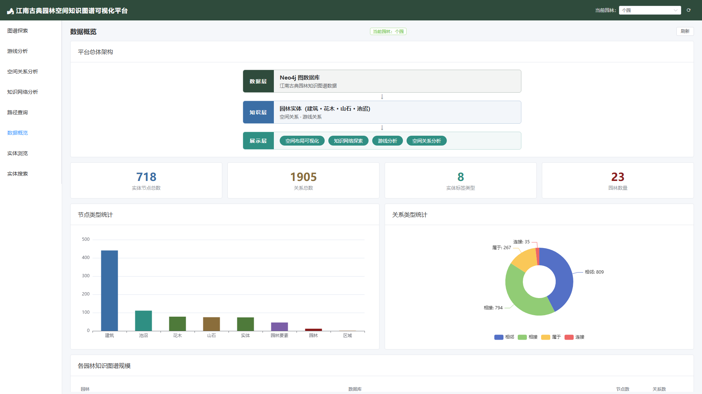
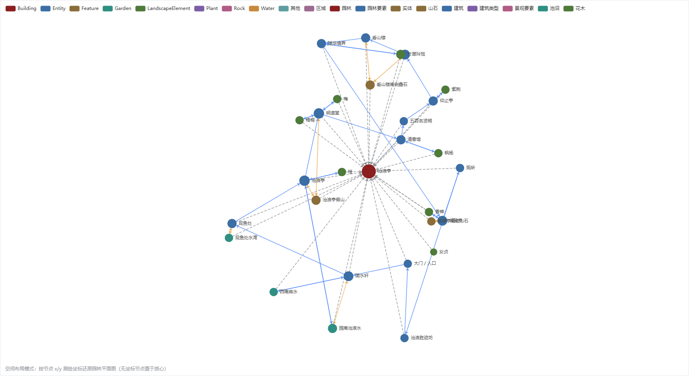
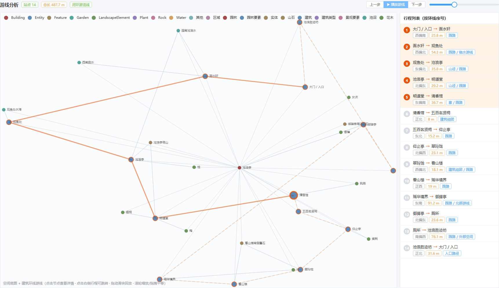
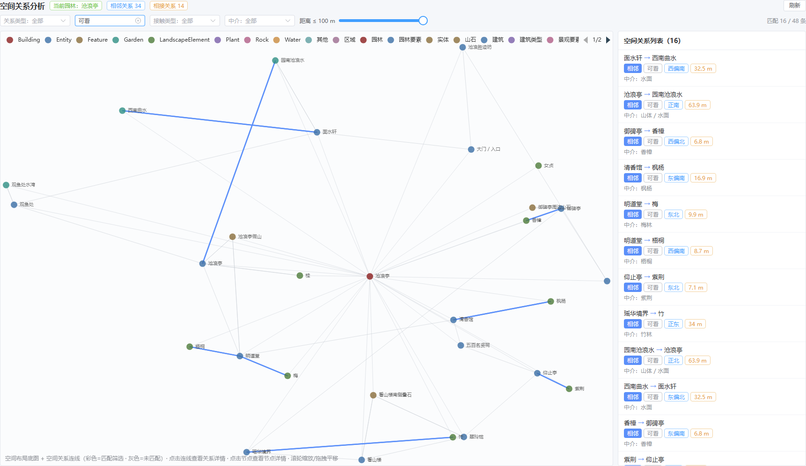
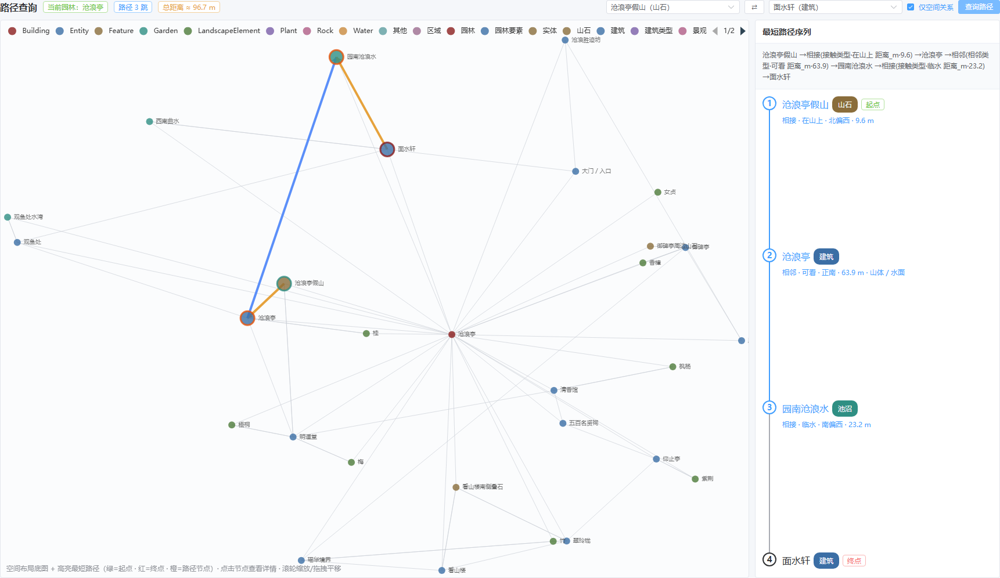
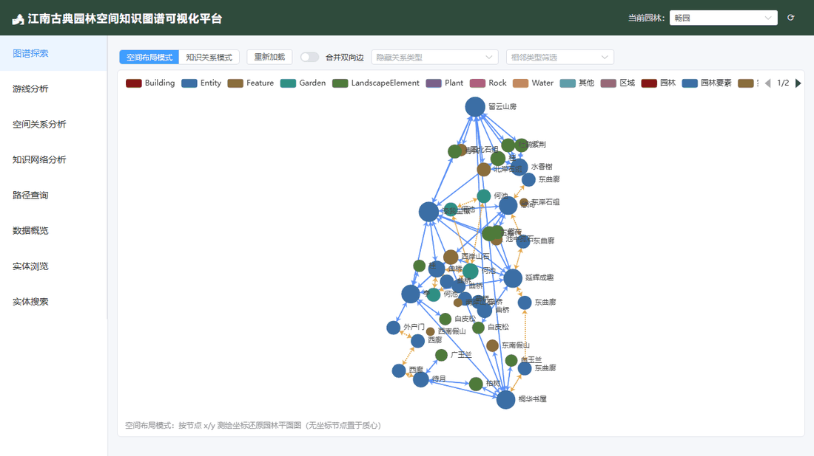
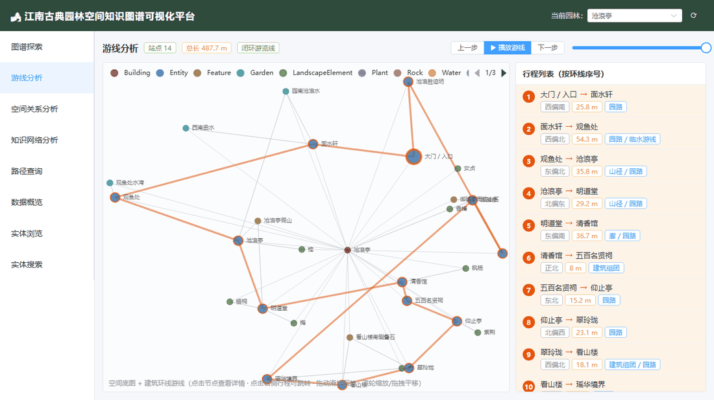
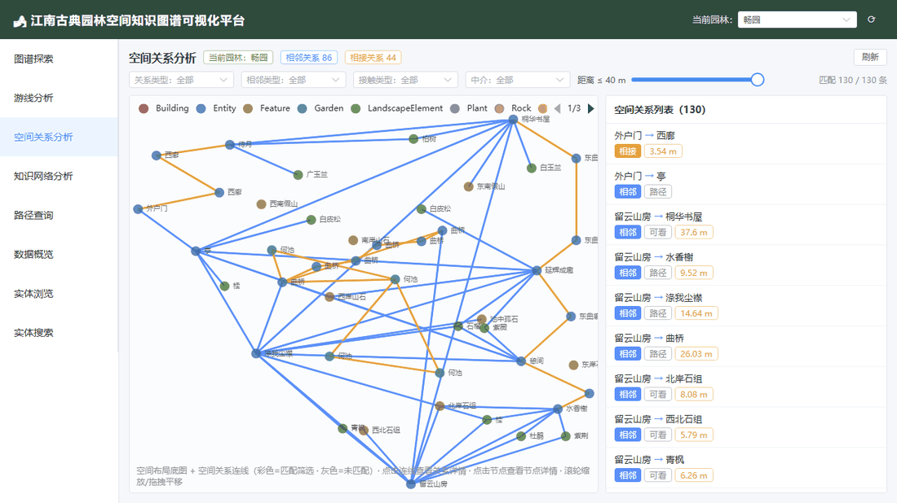
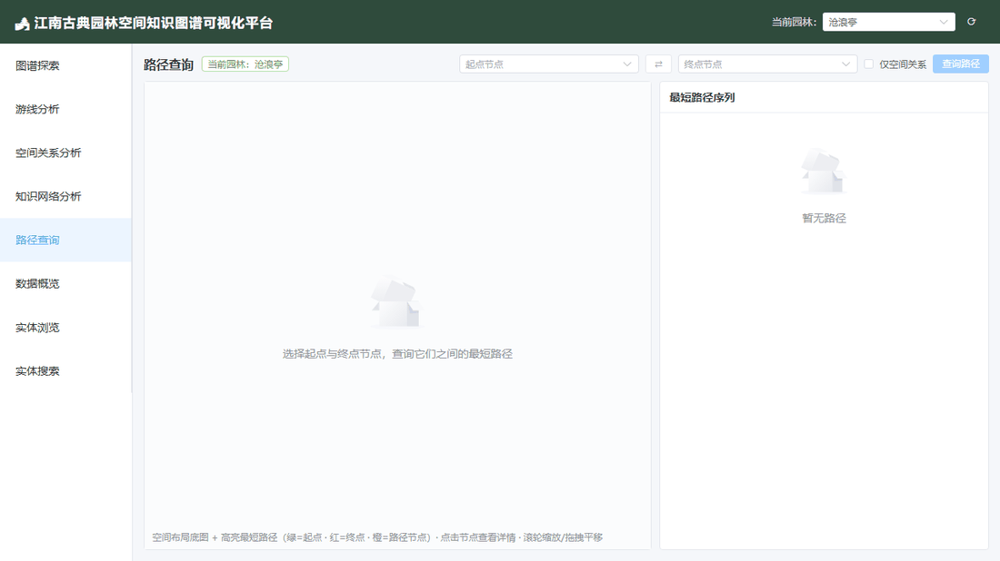

# 江南古典园林空间知识图谱可视化平台

> Jiangnan Classical Garden Spatial Knowledge Graph Visualization Platform

东南大学 SRTP 项目(项目编号:**202601018**)结项成果。以江南古典园林为研究对象,构建**带空间语义的知识图谱数据库**,并开发**可视化交互平台**,实现园林知识的浏览、检索、空间布局还原、游览动线复原与关系分析。



---

## 一、项目简介

中国古典园林具有复杂的空间关系和丰富的文化内涵,相关信息分散于测绘图纸、历史文献与属性数据表中,传统表格数据库难以表达园林要素之间"谁与谁相邻、相隔多远、以什么为中介"这类空间关联。

本项目采用**知识图谱技术**,以 Neo4j 图数据库组织园林实体及其关联关系,并针对园林建筑遗产的特点,提出**空间语义三层模型**建模方法。项目建成"数据库 + 平台 + 方法"三项核心成果:

| 成果 | 内容 |
|---|---|
| **知识图谱数据库** | 23 个江南古典园林,718 个要素,1905 条关系,覆盖苏州、扬州、南京等 8 市 |
| **可视化平台** | 8 个功能页面、13 项查询功能,全部实测通过 |
| **建模方法** | "空间语义三层模型"+"复杂要素拆解式表达",可为同类文化遗产数字化建档提供借鉴 |

---

## 二、核心成果

### 1. 江南古典园林空间知识图谱数据库(23 园)

- **规模**:23 个园林、**718 个要素、1905 条关系**,覆盖 8 个城市
- **覆盖范围**:既含拙政园、留园、沧浪亭、狮子林等现存名园,亦含乐郊园、影园等已消失园林
- **要素类型**:建筑(441)、池沼(111)、花木(78)、山石(75),均带编号、名称、类型、平面形式、屋顶形式、功能等属性,以及**以园门为原点的米制平面坐标**(x/y)与极坐标(极径/极角)
- **关系类型**:`属于`(267)、`相邻`(809)、`相接`(794)、`连接`(35),空间关系均记录**方位、距离、中介、语义类型**等信息

### 2. 知识图谱可视化平台(8 个功能页面)

| 页面 | 功能 |
|---|---|
| 数据概览 | 节点/关系/类型统计、园林库列表、数据库结构概览 |
| 实体浏览 | 按类别浏览园林要素,查看节点属性与关联数量 |
| 实体搜索 | 关键词搜索节点,查看详情与关联 |
| **图谱探索**(核心) | 知识关系模式(力导向布局,双击逐层展开)⇄ **空间布局模式**(按 x/y 测绘坐标还原园林平面图) |
| **游线分析** | 空间底图 + 建筑环线逐步动画,复原游览动线(沧浪亭 14 站闭环 487.7 m、狮子林 28 站 770.8 m) |
| **空间关系分析** | 关系统计 + 多条件筛选(关系类型/相邻类型/接触类型/中介/距离)+ 空间地图叠加 |
| **知识网络分析** | 网络指标、Top 核心节点、类型统计 |
| **路径查询** | 两点最短路径查询 + 空间地图高亮(绿=起点 · 红=终点 · 橙=途经) |

### 3. 空间语义建模方法

**空间语义三层模型** —— 将园林的空间语义归纳为三个层次:

```
┌─ 位置层:实体在哪里
│   节点属性 x / y(米制平面坐标,入口原点)
│   → 平台"空间布局模式"还原园林平面图
│
├─ 关系层:实体之间如何联系
│   相邻:相邻类型(建筑环线/可看/对景)+ 中介(园路、水面、山径…)+ 方向 + 距离
│   相接:接触类型(临水/在山上/在山边)+ 方向 + 距离
│   → 关系悬浮提示、详情面板、多条件筛选
│
└─ 游线层:游览动线如何组织
    建筑环线 + 环线序号
    → 游线分析模块按序号还原游览动线
```

**复杂要素拆解式表达** —— 折廊、曲桥、不规则水面等复杂形态要素,先拆解为逐段小要素,再从小要素视角记录细粒度空间关系,以保留建筑学研究所需的空间信息。

---

## 三、功能演示

### 空间布局还原(畅园)

按节点 x/y 测绘坐标还原园林平面图,y 轴自动翻转适配:



### 游线动画复原

建筑环线按序号逐步动画高亮,已走过 = 橙色实线 + 方向箭头,未走到 = 橙色虚线:



### 空间关系筛选与地图叠加

多条件筛选,彩色 = 匹配筛选、灰色 = 未匹配,点击连线查看关系详情:



### 路径查询

两点最短路径 + 空间地图高亮:



### 动图演示

| 畅园空间布局 | 游线播放 | 空间关系筛选 | 路径查询 |
|---|---|---|---|
|  |  |  |  |

---

## 四、技术架构


| 层次 | 技术 | 说明 |
|---|---|---|
| 前端 | Vue 3 + Vite + Element Plus + ECharts + Pinia | 页面展示、图谱可视化、交互;`/api` 自动代理到后端 |
| 后端 | Python + FastAPI + neo4j-driver | REST API、多库路由、动态 Schema 读取、Cypher 查询 |
| 数据库 | Neo4j(一园一库,共 23 个库) | 节点/关系存储、图谱查询 |

**核心设计原则**:

- **动态 Schema**:平台不预设任何实体分类,标签、关系类型、属性字段一律在运行时从 Neo4j 动态读取,前端图例、配色、筛选、详情面板随之动态生成——数据库中新增标签/关系,平台无需改代码即可适配
- **多库路由**:每个园林独立数据库,后端按库名路由,新园林 dump 加载后平台自动识别
- **前后端分离**:后端提供纯数据 API,前端独立部署

---

## 五、快速开始

### 环境要求

- Python 3.10+
- Node.js 18+
- Neo4j(5.x,本项目使用 Enterprise 版多库特性)

### 1. 加载知识图谱数据

`database/` 目录下为 23 个园林的 Neo4j dump 文件(每园一库),在 Neo4j 中为每个园林创建同名数据库并加载 dump(可使用 `neo4j-admin database load --from-path=<dump 目录> <库名>` 或 Neo4j Bloom/Data Importer)。

### 2. 启动后端

```bash
cd backend
cp .env.example .env          # 修改为你的 Neo4j 连接信息
pip install -r requirements.txt
python -m uvicorn main:app --port 8000
```

`.env` 配置项:

```ini
NEO4J_URI=neo4j://127.0.0.1:7687
NEO4J_USER=neo4j
NEO4J_PASSWORD=your_password_here
NEO4J_DB_IGNORE=system        # 忽略的库名(逗号分隔)
```

### 3. 启动前端

```bash
cd frontend
npm install
npm run dev
# 浏览器访问 http://localhost:5173(/api 自动代理到 8000)
```

---

## 六、API 概览

后端按功能域组织,统一挂载在 `/api` 前缀下:

| 模块 | 主要接口 | 说明 |
|---|---|---|
| `overview` | `/api/health` `/api/databases` `/api/overview` `/api/schema` | 健康检查、多库列表、数据总览、动态 Schema |
| `entities` | `/api/entities` `/api/entities/detail` | 实体浏览与搜索(按标签/关键词)、节点详情 |
| `graph` | `/api/graph/garden` `/api/graph/neighbors` | 全园子图、邻域子图(增量展开) |
| `spatial` | `/api/spatial/relations` `/api/path` | 空间关系查询、两点最短路径 |
| `analysis` | `/api/analysis/network` | 网络指标、Top 核心节点、类型统计 |

---

## 七、项目结构

```
Jiangnan-KG-Platform/
├── backend/                 # FastAPI 后端
│   ├── api/                 #   REST 接口(overview/entities/graph/spatial/analysis)
│   ├── services/            #   业务服务(图查询/空间分析/统计)
│   ├── db/                  #   Neo4j 驱动与查询封装
│   ├── config.py            #   多库路由与名称映射
│   ├── main.py              #   应用入口
│   └── .env.example         #   环境变量模板
├── frontend/                # Vue 3 前端
│   ├── src/views/           #   8 个功能页面
│   ├── src/components/      #   图谱画布/节点详情面板/统计卡片等
│   └── vite.config.js       #   /api 代理配置
├── database/                # 23 个园林 Neo4j dump + schema 分析报告
├── docs/                    # 设计方案、结题报告、答辩材料、平台截图
├── images/                  # 测绘图纸、实地照片等素材
└── tools/                   # 演示 GIF 生成、PPT 制作等辅助脚本
```

---

## 八、文档

- 平台设计方案:[`docs/platform_design.md`](docs/platform_design.md)(v2.1,空间知识图谱定位)
- 数据库 Schema 分析:[`database/schema.md`](database/schema.md)
- 功能需求:[`docs/function_requirements.md`](docs/function_requirements.md)
- 研究总报告:[`docs/结题报告-研究总报告.md`](docs/结题报告-研究总报告.md)
- 成果简述:[`docs/结题报告-成果简述.md`](docs/结题报告-成果简述.md)
- 结项答辩材料:[`docs/江南古典园林空间知识图谱——结项答辩.pptx`](docs/江南古典园林空间知识图谱——结项答辩.pptx)

---

## 九、项目信息

- **项目来源**:东南大学 SRTP(大学生科研训练计划),项目编号 202601018
- **研究时段**:2026 年立项,2026 年 10 月结项
- **后续计划**:结合大语言模型实现自然语言知识查询(`/api/qa` 已预留),探索 AI 辅助园林复原
